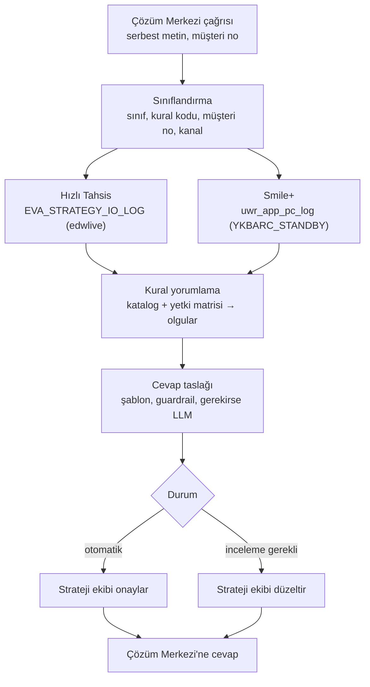
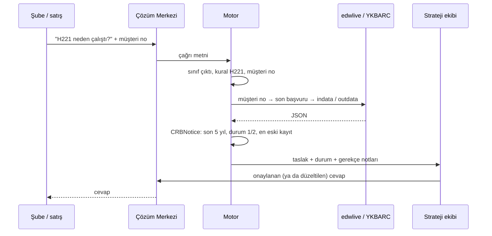

# Strateji Cevap Motoru: nasıl çalışıyor

Ekim 2026. Bu belgeyi, strateji çıktılarıyla ilgili çağrılara otomatik cevap taslağı üreten motorun
mimarisini anlatmak için yazdık. Kod repoda `strateji-cevap/` altında; buradaki her bileşenin karşılığı
tek bir Python dosyası. Ayrıntılı plan, varsayımlar ve açık sorular `docs/UYGULAMA_PLANI.md`'de
duruyor; bu belge daha kısa ve resmin bütününe bakıyor.

## Sorun

Kurumsal ve ticari kredi başvuruları strateji motorundan geçiyor. Motor bir başvuru için onlarca kural
çalıştırıyor, onay yetki seviyesini hesaplıyor ve girdisini/çıktısını log tablosuna JSON olarak yazıyor.
Şubeler ve satış ekipleri sonucu Sparx ekranında görüyor; ama "bu müşteride H221 neden çalıştı", "onay
yetkisi neden 8" gibi sorular için Çözüm Merkezi üzerinden strateji ekibine çağrı açıyorlar. Ayda
yaklaşık 120 çağrı geliyor. Ekipten biri başvuruyu buluyor, JSON'a bakıyor, kuralın ne yaptığını
hatırlıyor ve cevabı elle yazıyor. Soruların büyük kısmı aynı birkaç kural etrafında dönüyor ve cevaplar
birbirine benziyor.

Yapmak istediğimiz şu: çağrı geldiğinde motor başvuruyu kendisi bulsun, kuralın neye baktığını JSON'dan
çıkarsın, ekibin onayladığı şablonla cevap taslağını yazsın. Ekip taslağı okuyup onaylasın ya da düzeltsin.
Cevabın şubeye kendi kendine gitmesini şimdilik istemiyoruz; önce taslakların ne kadar tutturduğunu
görmek istiyoruz.

## Akış

Çağrı önce sınıflandırılıyor. Üç sınıf var: çıktı soruları ("kural neden çalıştı", "yetki seviyesi neden
bu"), girdi soruları ("KKB verisi yanlış geliyor") ve hata bildirimleri. Yalnız çıktı sorularına otomatik
taslak üretiyoruz; diğer ikisi yönlendirme notuyla ekibe düşüyor. Sınıflandırıcı kural kodunu ve müşteri
numarasını metinden düzenli ifadeyle alıyor. LLM varsa sınıfı LLM belirliyor, ama metinde olmayan bir
kodu ya da numarayı üretmesine izin vermiyoruz.

Sonra başvuru bulunuyor. İki kanal var. Hızlı Tahsis başvuruları EVA tablolarında: müşteri numarasından
`Eva_Identity` ve `Eva_Evaluation` üzerinden başvuru numarasına, oradan `EVA_STRATEGY_IO_LOG` kaydına
gidiliyor; `indata` ve `outdata` sütunları strateji motorunun gördüğü ve ürettiği JSON. Smile+ teklifleri
`UWR_PRO_PROPOSALS` tablosunda; log tablosuna (`uwrarch.uwr_app_pc_log`) grup teklif numarasıyla
bağlanıyor, çünkü üye müşteri üzerinden girilen tekliflerde log grup numarasında tutuluyor. Bu sorgular
Boran'ın gönderdikleriyle aynı; motor yalnız okuyor, hiçbir tabloya yazmıyor. Kural açıklamalarının
tutulduğu `APP_POLICY_RULE_LKP` tablosu kataloğun açıklama alanını besleyecek. Bir ayrıntı: Sparx
ekranında yalnız D ve H kuralları görünüyor, oysa logdaki `outdata`'da CR gibi başka kurallar da var.
Şubecinin sorduğu kuralla logdaki kural kümesi her zaman örtüşmeyebilir; motor bunu fark edip taslağa not
düşmeli.

Kural yorumlama deterministik. Her kural için katalogda üç şey yazıyor: JSON'da nereye bakılacak, hangi
koşul süzülecek, hangi şablon doldurulacak. H221 için bu, `Indata.CRBNotice` listesinde son beş yılda
durumu 1 ya da 2 olan en eski kayıt; cevaba o kaydın ay-yılı ve raporu alan bankanın bizden farklı olup
olmadığı giriyor. Yetki seviyesi sorularında nominal ve ağırlıklı limit matristen geçiriliyor, iki
limitten hangisi daha yüksek seviyeye çıkarıyorsa o alınıyor, sonra H kurallarının zorladığı seviyeyle
karşılaştırılıyor; nihai seviye büyük olan. Motor hesapladığı seviyeyi JSON'daki `APPROVALAUTHORITY` ile
karşılaştırıyor. Tutmazsa taslak "inceleme gerekli" oluyor, çünkü ya matris dosyamız eskimiştir ya da
yanlış alana bakıyoruzdur.

Taslak şablondan kuruluyor. Tek kurallı sorularda LLM hiç devreye girmiyor; şablon metni olduğu gibi
gidiyor. Birden çok kural sorulmuşsa şablon metinlerini LLM tek akıcı mesaja topluyor, ama çıkan metin
taslaktaki olgularla karşılaştırılıyor: bir tarih, tutar ya da kural kodu değişmiş ya da düşmüşse LLM
metni atılıyor ve şablonların art arda eklenmiş hali gidiyor.

## Tek bir çağrının hayatı

Ekibin düzelttiği her taslağı saklıyoruz. Düzeltmeler iki işe yarıyor: hangi şablonun eksik olduğunu
gösteriyor ve ikinci fazda otomatik gönderim eşiğini belirlerken elimizde gerçek bir ölçüm oluyor.

## Bileşenler

| Dosya | Görev | LLM |
|---|---|---|
| `motor.py` | boru hattı, komut satırı, toplu çalıştırma | hayır |
| `siniflandirici.py` | sınıf, kural kodları, müşteri numarası | sınıf için isteğe bağlı |
| `veri.py` | başvuru JSON'u; bugün klasörden, hedefte iki DB uyarlayıcısı | hayır |
| `katalog.py`, `katalog/kurallar.json` | kural tanımları, şablonlar, onay durumu, geçerlilik tarihi | hayır |
| `cozumleyici.py` | kuralı JSON'a uygular, olguları çıkarır | hayır |
| `matris.py`, `katalog/yetki_matrisi.json` | limit → seviye; nihai = büyük olan | hayır |
| `yazici.py` | taslak kurma, guardrail doğrulaması, yeniden yazım | çok kuralda isteğe bağlı |
| `llm.py` | kurum içi Qwen (vLLM, OpenAI uyumlu uç nokta) | evet |
| `analiz_smile.py`, `excel_dok.py` | Smile dökümü analizi; Excel yapı dökümü | hayır |

Kataloğun sahibi strateji ekibi. Biz biçimi koruyoruz ve bozuk kataloğu yükletmeyen testi çalıştırıyoruz.
Bir kural değişince eski satır silinmiyor; bitiş tarihi yazılıyor, aynı kodla yeni satır ekleniyor. Cevap,
başvurunun tarihinde geçerli olan sürümle üretiliyor. Böylece geçen yılki bir başvuru için bugünkü kuralla
yanlış açıklama yazmıyoruz.

Yetki matrisi Excel'den JSON'a bir kere aktarılıyor ve sürümleniyor. Excel'de sarı hücreler girdi
(nominal ve ağırlıklı limit), yeşil hücre seviye. Hangi ağırlıklı limitin (nakit teminat dahil mi, hariç
mi) matrise girdiğini ve `PATHID`'ye göre ayrı tablo olup olmadığını Excel'in dökümünden çıkaracağız;
gerekirse matris dosyası tablo başına ayrılır.

## LLM'in sınırları

LLM kurum içinde çalışıyor, dışarıya veri çıkmıyor. Yalnız iki işi var: çağrının sınıfını belirlemek ve
birden çok kuralın şablon metnini tek mesaja toplamak. Bunun dışında kalan her şey kod. Sayı, tarih,
kural kodu ve müşteri numarası LLM'den gelmiyor; gelirse atılıyor. Onaysız şablonla üretilen cevap
otomatik gitmiyor. Sorulan kural başvuruda çalışmamışsa, ya da veriyle katalog birbirini tutmuyorsa
taslak incelemeye düşüyor. İngilizceye kayan ya da yarım kalan cevap kullanılmıyor. Cevapta müşteri adı
geçmiyor, yalnız numara. LLM servisi kapalıysa motor aynı cevapları şablonla üretiyor; kalite düşmüyor,
yalnız çok kurallı cevaplar daha az akıcı oluyor.

## Veri ve gizlilik

Smile dökümü, gerçek başvuru JSON'ları, Excel dosyaları ve üretilen raporlar `veri/` altında duruyor;
`.gitignore` bu klasörü ve tüm xlsx/csv dosyalarını dışarıda tutuyor. Repoya yalnız sentetik örnek giriyor.
İş bilgisayarından çıkamayan dosyalar için `excel_dok.py` yazdık: sayfa, başlık, sütun tipi ve dağılımı
yazıyor, altı ve daha çok haneli sayıları maskeliyor, serbest metni dışarı vermiyor. Yetki Excel'i için
hücre modu (`--hucreler`) sarı ve yeşil dolguları, formülleri ve birleşik alanları da döküyor. Tarihsel
çağrıları geliştirmede kullanmadan önce KVKK onayını netleştireceğiz.

## Ölçme

Değerlendirme seti smile2025'ten çıkacak: en sık kurallardan örneklenmiş 100–200 çağrı, ekibin verdiği
cevapla motorun taslağı yan yana. Dört şeye bakacağız: motorun bir kurala eşleyebildiği çağrı oranı
(hedef en az %70), taslaktaki tarih, sayı ve kural kodunun ekibin cevabıyla aynı olması (en az %95),
pilotta ekibin hiç değiştirmeden gönderdiği taslak oranı (hedef workshop'ta netleşecek, %60 civarı) ve
çağrı başına harcanan süre, önce ve sonra.

## Nerede duruyoruz

Prototip iskeleti sentetik veriyle uçtan uca çalışıyor; 67 test var, LLM ya da ağ gerektirmiyor. Gerçek
JSON yolları, Excel'den üretilmiş matris, iki kanallı veri katmanı, MVP kural listesi ve şablon onayları
henüz yok. Hepsi şu dosyalara bağlı:

1. İki Excel'in `excel_dok.py` dökümü (yetki Excel'i hücre moduyla).
2. Hızlı Tahsis ve Smile+'tan birer tam log kaydı (`indata` + `outdata`), müşteri numaraları maskeli.
3. `APP_POLICY_RULE_LKP` dökümü (kod ve açıklama).
4. edwlive ve YKBARC_STANDBY için salt okunur erişim; Python'dan Oracle bağlantısı.
5. Çözüm Merkezi kaydının alanları ve cevabın nasıl geri yazıldığı.
6. Pilotta taslağı kimin onaylayacağı.

Takvim: veri analizi ve workshop bir hafta, MVP üç hafta, pilot üç hafta, sunum 2027 planlama dönemine.
Dosyalar ilk iki haftada gelirse dokuz haftada bitiyor.
