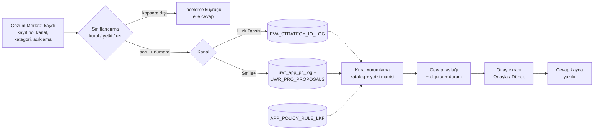
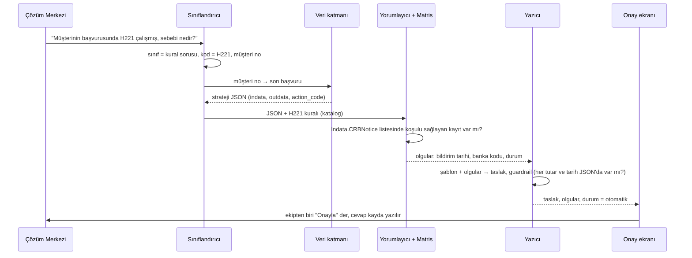
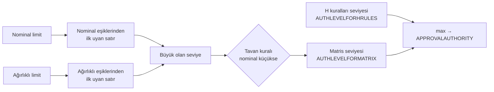

# Strateji Cevap Motoru — Proje Belgesi

*Kurumsal ve Ticari Krediler Strateji ekibi · Ekim 2026 · Sürüm 1*

## 1. Neden yapıyoruz

Çözüm Merkezi'ne ayda ortalama 54 kayıt düşüyor; hemen hepsi aynı soruların türevleri: "Bu başvuruda H221 neden çalıştı?", "Onay yetki seviyesi neden bu kadar yüksek çıktı?", "Strateji ret verdi, nedeni ne?". Kayıtların yarısı IVR'dan, yüzde 38'i Web'den geliyor. Ekip bunların ayda 34 kadarını kendi kapatıyor; kalanı başka ekiplere gidiyor ve bir kayıt kapanana kadar ortalama altı kez el değiştiriyor. Transfer nedenlerinde "hatalı ekibe transfer" üçüncü sırada. Yani sorun iki katmanlı: soruyu doğru yere düşürmek, sonra da cevabı her seferinde elle başvuru kaydını açıp JSON içinden kural kodu, limit ve seviye okuyarak yazmak.

Cevapların çoğu şablon: aynı cümleler ufak farklarla tekrar ediyor. Bu, otomatikleştirilebilir bir iş: olgular (hangi kural çalıştı, hangi tarihte, hangi limitle, hangi seviye) başvurunun strateji log kaydında zaten duruyor; metin kalıbı da ekibin elinde.

Hedef: Çözüm Merkezi'ne düşen kaydı okuyan, ilgili başvurunun strateji çıktısını çeken, kuralı ve yetki seviyesini yorumlayıp **onaya hazır bir cevap taslağı** üreten ve bunu ekibin önüne bir ekranda koyan sistem. Taslak kendi başına gönderilmez; ekipten biri onaylar ya da düzeltir. Dil modeli yalnız iki yerde çalışır: soruyu sınıflandırmak ve birden çok kural aynı anda çalışmışsa cümleleri tek metinde toplamak. Olgu üretmez.

## 2. Uçtan uca akış

Akışın her adımı ayrı bir dosya; biri değişince diğerleri etkilenmiyor:

| Adım | Dosya | Ne yapar |
|---|---|---|
| Sınıflandırma | `siniflandirici.py` | Kayıt açıklamasından soru tipini (kural / yetki / ret / kapsam dışı), kural kodlarını (H221, CR…) ve müşteri ya da başvuru numarasını çıkarır. Önce düzenli ifade, gerekirse LLM. |
| Veri | `veri.py` | Numaradan başvurunun strateji JSON'unu getirir. İki kaynak: dosya (geliştirme, sentetik örnekler) ve veritabanı (Hızlı Tahsis, Smile+). Bağlantı bilgileri `config.json`'da. |
| Yorumlama | `cozumleyici.py`, `matris.py` | Katalogdaki kuralı JSON'a uygular: koşulu doğrular, tarih/tutar/seviye gibi olguları çıkarır. Yetki sorusunda nominal ve ağırlıklı limiti matristen geçirir. |
| Katalog | `katalog/kurallar.json` | Her kural için veri yolu, koşul, cevap şablonu, onay durumu ve geçerlilik tarihi. Ekip yönetir, kod değişmez. |
| Yazım | `yazici.py` | Şablonları tek metne kurar, guardrail'den geçirir, durumu belirler. |
| Ekran | `ekran.py` | Kayıt listesi, kayıt detayı, Onayla / Düzelt. |

## 3. Bir çağrının hayatı

Guardrail kuralları basit ve kesin: taslaktaki her sayı, tarih ve kural kodu başvuru JSON'unda ya da katalogda geçmek zorunda; geçmeyen bir ifade varsa durum `inceleme_gerekli` olur ve ekran taslağı "düzelt" moduyla açar. Onaysız (taslak) şablon, çalışmamış bir kural için gelen soru, iki kaynak arasında tutarsızlık ve tanımadığımız kural kodu da aynı şekilde incelemeye düşer. Otomatik durum yalnızca her şey yerindeyse verilir; o zaman bile gönderme kararı insanda.

## 4. Veri kaynakları ve yetki matrisi

Hızlı Tahsis başvuruları `EVA_STRATEGY_IO_LOG` tablosunda tutuluyor: her satırda stratejiye giren veri (`indata`), çıkan veri (`outdata`) ve karar (`action_code`). Müşteri numarasından kimlik ve değerlendirme tablolarıyla başvuru numarasına ulaşılıyor. Smile+ başvuruları `uwr_app_pc_log` arşivinde; teklif tablosuyla grup teklif numarası üzerinden eşleşiyor. Kural açıklamaları `APP_POLICY_RULE_LKP`'de; Sparx'ta yalnız D ve H kuralları görünüyor, CR kuralları `outdata` içinde karşımıza çıkıyor. Bu dört tablonun bağlantı bilgisi `config.json`'da boş alanlar olarak duracak; ekipten biri doldurur, kod gerisini yapar. Bağlantı yoksa motor sentetik dosya örnekleriyle çalışmaya devam eder, ekran "kaynak: dosya" diye gösterir.

Yetki seviyesi sorusu ayrı bir mantık ister. Strateji çıktısında `CORPCOMMMATRIXOUTPUTS` altında nominal limit ve nakit teminat düşülmüş ağırlıklı limit var; `AUTHLEVELFORMATRIX` matristen gelen seviyeyi, `AUTHLEVELFORHRULES` H kurallarının zorladığı seviyeyi, `APPROVALAUTHORITY` ise ikisinin büyüğünü taşıyor. Matrisin kaynağı "Kurumsal ve Ticari Kredi Onay Yetki Seviyeleri" Excel'i; motor eşikleri elle kopyalamak yerine doğrudan bu dosyadan okur. Standart tahsis sayfasında satırlar segment bloklarına (Kurumsal, Ticari, OBİ, KOBİ/Tarım, Perakende, tüm segment) ayrılıyor; her satır bir onay makamı, yanında ağırlıklı ve nominal eşik; blok içinde aşağı indikçe seviye yükseliyor. Bazı bloklarda bir satır nominal limitin belli bir eşiğin altında ya da üstünde olmasına göre ikiye bölünüyor ve dipnotta bir tavan kuralı var: nominal o eşiğin altındaysa, ağırlıklı limit ne olursa olsun seviye belirli bir direktörlüğü geçmiyor. Bu kural da motorda ayrıca uygulanır.

Excel'i okuyan betik (`matris_excel.py`) dosyadan `yetki_matrisi.json` üretir; matris güncellenince betik yeniden koşulur, kod değişmez. Motor bu dosya varsa onu, yoksa geliştirme için hazırlanmış sentetik matrisi kullanır ve cevapta hangisini kullandığını söyler.

## 5. Ekran

Ekip ayrı bir araç öğrenmesin diye tek sayfa: solda Çözüm Merkezi'nden gelen kayıtlar, sağda tıklanan kaydın detayı. Durum rengi listede görünür; önce incelemeye düşenler gelir.

<b>Kayıtlar</b> &nbsp;filtre: durum · kanal · tarih
<table style="margin-top:6px;font-size:.78rem;width:100%;table-layout:fixed"><colgroup><col style="width:36%"><col style="width:24%"><col style="width:40%"></colgroup><tr><th>Kayıt</th><th>Tarih</th><th>Durum</th></tr>
<tr style="background:#fff3cd"><td>I######</td><td>14.10</td><td>inceleme</td></tr>
<tr style="background:#e8f5e9"><td>I######</td><td>14.10</td><td>otomatik</td></tr>
<tr><td>I######</td><td>13.10</td><td>gönderildi</td></tr>
<tr><td>I######</td><td>13.10</td><td>düzeltildi</td></tr></table>

<b>Kayıt I###### · Yetki seviyesi sorusu · Hızlı Tahsis</b> 

<i>Sorulan:</i> "Müşterinin başvurusunda onay yetki seviyesi neden 8 çıktı, matrise göre daha düşük olmalıydı."

<i>Taslak:</i> Başvurunun nominal limiti ve ağırlıklı limiti Ticari segment matrisinde … seviyesine denk geliyor; başvuruda H… kuralı çalıştığı için H kuralı seviyesi … ve nihai seviye ikisinin büyüğü olarak 8 belirlendi.

<i>Olgular:</i> nominal limit · ağırlıklı limit · segment · matris satırı · çalışan H kuralları · tarih &nbsp;|&nbsp; <i>Kaynak:</i> EVA_STRATEGY_IO_LOG, matris: Excel 2026-10 
<i>Durum:</i> otomatik &nbsp; <i>Notlar:</i> — 

Onayla &nbsp; Düzelt &nbsp; Kapsam dışı

"Düzelt" denince taslak düzenlenebilir olur, düzeltilmiş metin kaydın yanında saklanır ve hangi şablonun ne sıklıkla düzeltildiği ölçülür; en çok düzeltilen şablon katalogda gözden geçirilir. "Kapsam dışı" kaydı ekibe bırakır ve sınıflandırıcıya örnek olarak işaretler. Onay ve düzeltme bilgisi sunucuda, repo dışında bir dosyada tutulur; ilk sürümde veritabanı gerekmez.

## 6. Dil modelinin sınırları

Kurum içi Qwen modeli (vLLM, OpenAI uyumlu uç) iki iş yapar: düzenli ifadenin çözemediği soruyu sınıflandırmak ve birden çok kuralın şablon cümlelerini akıcı tek paragrafta toplamak. Her iki durumda da çıktı guardrail'den geçer: modelin yazdığı metindeki her sayı, tarih ve kural kodu şablon girdisinde olmak zorunda; fazladan bir şey varsa model çıktısı atılır, şablon metni kullanılır ve kayıt incelemeye düşer. Model başvuru verisine doğrudan bakmaz; ona yalnız şablon cümleleri verilir. Model kapalıysa sistem şablonlarla çalışmaya devam eder, yalnız çok kurallı cevaplar biraz daha kuru olur.

## 7. Gizlilik ve çalışma düzeni

Müşteri verisi, yetki matrisi ve gerçek başvuru kayıtları kurum ağının dışına çıkmaz; kod deposunda yalnız kod, sentetik örnekler ve bu belgeler bulunur. Gerçek veriyle her şey kurum içindeki sunucuda çalışır: veritabanı bağlantıları, matris dosyası, cevap taslakları ve onay kayıtları orada kalır; dil modeli de kurum içi uçtan çağrılır, dışarıya hiçbir istek gitmez. Ekranı kullanan kişinin yaptığı onay ve düzeltmeler kayıt numarasıyla birlikte saklanır; böylece hangi cevabın kimin onayıyla gittiği sonradan izlenebilir.

## 8. Yapım planı

Prototip iskeleti var ve sentetik veriyle çalışıyor (68 test, dil modeli ve ağ gerektirmiyor). Sıradaki iş uçtan uca çalışan bir sürüm; parçalar birbirinden bağımsız olduğu için paralel ilerleyecek:

1. **Yetki matrisi** — `matris_excel.py` okuyucu, `config.json`'da `matris_dosya`, `matris.py`'ye segment ve tavan kuralı. Doğrulama: ekibin verdiği örnek başvuru (nominal, ağırlıklı, beklenen seviye) ile aynı sonucu vermesi.
2. **Veri katmanı** — dosya ve veritabanı kaynağı tek arayüz; dört tablo için sorgular ve `config.json` alanları; sürücü yoksa dosya kaynağına düşer. Katalogdaki veri yolları gerçek kayıt yapısıyla karşılaştırılıp doğrulanır.
3. **Örnek kayıtlar** — Çözüm Merkezi kaydının alan düzeninde 10–20 sentetik kayıt ve eşleşen başvuru JSON'ları; H221, yetki ve ret senaryoları. Geliştirme ve testler bunlarla yürür.
4. **Ekran** — standart kütüphaneyle sunucu ve tek sayfa; liste, detay, Onayla / Düzelt / Kapsam dışı.
5. **Testler ve belgeler** — her parçaya test; README ve uygulama planı güncellemesi.

Ekipten beklediklerimiz: `AUTHLEVELFORMATRIX`'teki seviye numarası ile matristeki onay makamı unvanlarının eşlemesi; müşteri segmentinin strateji JSON'unda hangi alanda olduğu; OBİ ve KOBİ bloklarındaki "Otomatik Onay" satırının seviye numarası; Hızlı Tahsis ve Smile+ için `config.json` bağlantı bilgileri; birer örnek Hızlı Tahsis ve Smile+ kaydının alan yapısı. Ölçüm, ilk aydan itibaren: kayıt başına otomatik / inceleme oranı, düzeltilen şablon sayısı, kapanış süresi ve transfer sayısındaki değişim.
